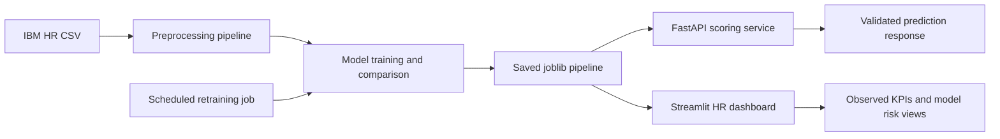

# System Architecture

The local implementation separates training, model persistence, scoring, and presentation. The IBM guide maps the same flow to Watson Studio Jobs and Watson Machine Learning after credentials become available.
